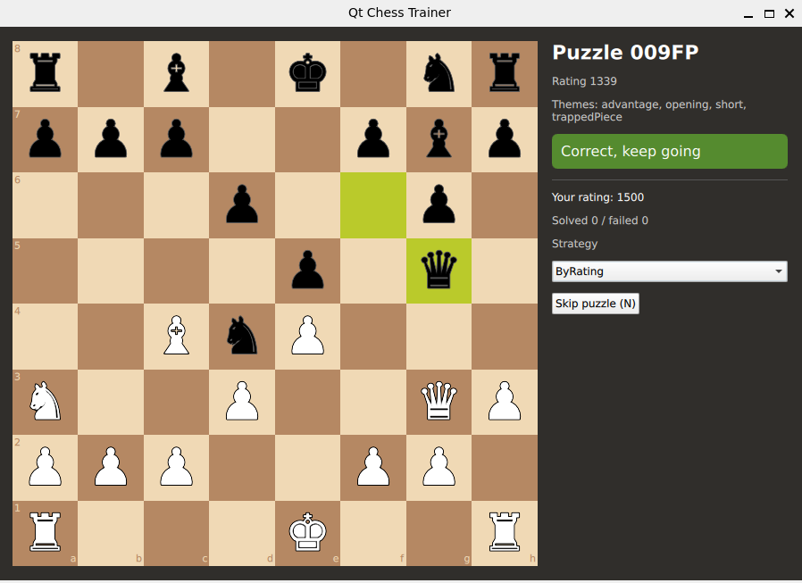
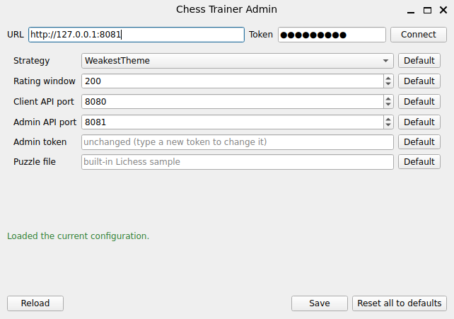

# Qt Chess Trainer

A desktop chess tactics trainer built with **Qt 6 / QML and C++20**, as a hands-on learning
project. Puzzles come from the Lichess database; the next puzzle is chosen by a switchable
strategy; a client REST API and a token-protected admin REST API run alongside the GUI; a
PySide6 tool edits the configuration while the app runs.

## Features

- Click-to-move board with last-move highlight, feedback banner and player rating (Elo)
- Three selection strategies, switchable at runtime: Random, ByRating, WeakestTheme
- Client REST API on port 8080: start puzzles, submit moves, read statistics
- Admin REST API on port 8081 with `X-Admin-Token`: view, change and reset the configuration
- PySide6 admin GUI for the admin API
- 22 C++ tests (QTest, QtQuickTest, smoke and end-to-end) and 19 Python tests, run by CI

## Quick start (Ubuntu or WSL)

    scripts/install-deps.sh
    cmake -S . -B build -G Ninja
    cmake --build build
    ctest --test-dir build --output-on-failure
    ./build/src/app/trainer_app

The first configure needs network access (CMake fetches chess-library and cpp-httplib).

Admin GUI:

    python3 -m venv .venv && . .venv/bin/activate
    pip install -r tools/admin_gui/requirements.txt
    TRAINER_ADMIN_TOKEN=change-me python tools/admin_gui/admin_gui.py

## Configuration

The app reads `config/config.local.json` (ignored by git, created on the first change; see
`config/config.default.json` for the keys). Use `--config <file>` for another file. Change the
admin token before using the admin API on a shared machine.

## Documentation

| Document | Contents |
|---|---|
| [Problem definition](docs/ProblemDefinition.md) | requirements R1–R8 |
| [Architecture](docs/Architecture.md) | layers, patterns, diagrams |
| [Traceability](docs/Traceability.md) | requirement → code → tests |
| [REST APIs](docs/API.md) | client and admin endpoints |
| [Admin GUI](docs/AdminGui.md) | the PySide6 tool |
| [Puzzle format](docs/PuzzleFormat.md) | CSV columns and data sources |

## Project layout

    src/core        trainer_core: puzzles, chess logic, strategies, statistics, config, facade
    src/api         trainer_api: client and admin HTTP servers
    src/app         trainer_ui + trainer_app: board model, QML bridge, QML files
    tools/admin_gui PySide6 admin GUI and the admin end-to-end check
    tests           unit, QML and smoke tests
    docs            documentation and PlantUML diagrams

## How it was built

Pull requests each with couple commits and green CI: skeleton,
puzzle data, move validation, strategies, facade, QML board, interaction, client API,
configuration and admin API, admin GUI, documentation.

## Credits and licences

- Code: MIT (see [LICENSE](LICENSE))
- Puzzles: [Lichess puzzle database](https://database.lichess.org/#puzzles), CC0
- [chess-library](https://github.com/Disservin/chess-library) by Disservin, MIT
- [cpp-httplib](https://github.com/yhirose/cpp-httplib) by yhirose, MIT