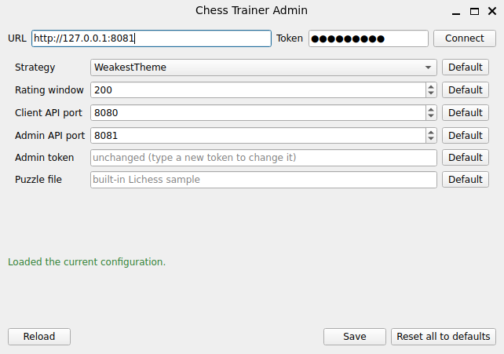

# Admin GUI

A PySide6 tool for the admin REST API (see API.md). It shows the current configuration,
edits it, and resets values to their defaults.

## Run

    python3 -m venv .venv && . .venv/bin/activate
    pip install -r tools/admin_gui/requirements.txt
    ./build/src/app/trainer_app &
    TRAINER_ADMIN_TOKEN=change-me python tools/admin_gui/admin_gui.py

Options: `--url` (default `http://127.0.0.1:8081`, or `TRAINER_ADMIN_URL`) and `--token`
(prefer the `TRAINER_ADMIN_TOKEN` variable, so the token is not visible in the process list).

## Using it

| Control | Effect |
|---|---|
| Connect | reads the configuration with the URL and token above |
| Save | sends only the fields you changed |
| Default (per field) | resets that key on the server now; other unsaved edits stay |
| Reset all | resets every key, including the token, after a confirmation |
| Admin token field | empty means unchanged; type a new token to change it |

Port and puzzle-file changes are saved, and the message line says the trainer must be
restarted to apply them. After a token change or reset, the GUI switches to the new token.

## Structure

| Module | Role |
|---|---|
| `admin_client.py` | HTTP client, standard library only |
| `config_form.py` | editors and Default buttons, tracks which fields changed |
| `admin_gui.py` | main window; receives a client factory, so tests use a fake client |
| `e2e_check.py` | drives the real trainer_app through `admin_client.py` (run by ctest) |

Tests: `QT_QPA_PLATFORM=offscreen python -m pytest tools/admin_gui/tests -v

