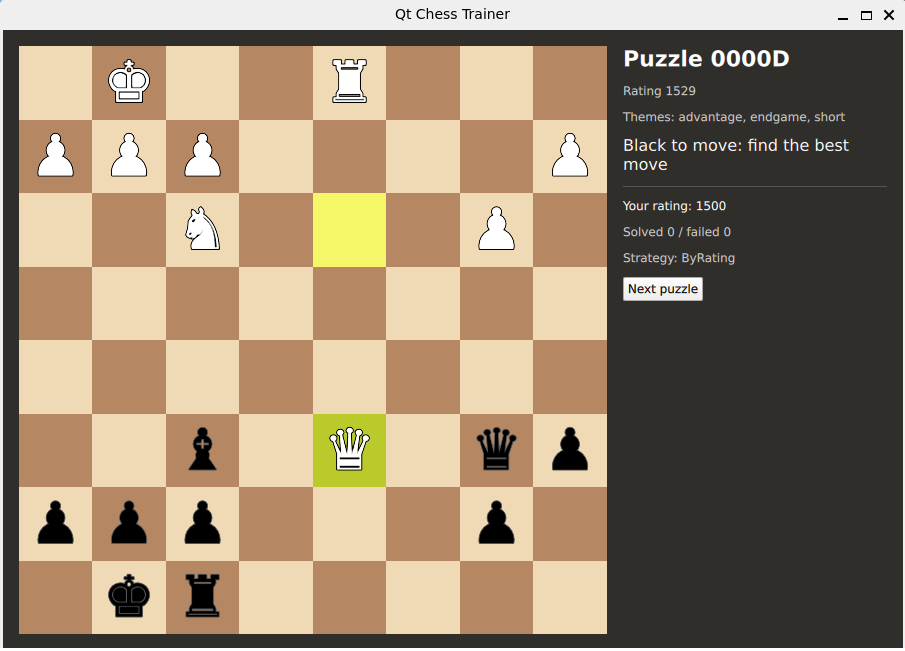

# Architecture

## Admin: change the selection strategy

Source: diagrams/admin-config-change.puml (CI renders it to SVG and uploads it as the
"diagrams" artifact of every workflow run).

The admin GUI sends PUT /config with a token. The admin server verifies the token,
ConfigService validates and persists the change, and TrainerService swaps.

## Chess logic boundary

`ChessPosition` is an adapter: it is the only code that includes `chess.hpp`
(chess-library, MIT, fetched with CMake FetchContent). Everything else works with
FEN strings and UCI move strings. `PuzzleSession` owns the per-puzzle state and
uses `MoveValidator`, which accepts the stored solution move or any legal move
that gives checkmate.

## Strategy: puzzle selection

`IPuzzleSelector` is the Strategy interface. Implementations:

| Name | Behaviour |
|---|---|
| Random | any puzzle not played recently |
| ByRating | random puzzle within playerRating ± ratingWindow, else the closest rating |
| WeakestTheme | the theme with most failures, closest rating; delegates to ByRating without data |

`SelectorRegistry` creates a selector from its name. The active name will come
from `config.json` , so the admin can switch strategies at runtime.
Selectors are pure: all input arrives through `SelectionContext`, and the
random generator is seeded, which keeps the tests deterministic.

## Facade: TrainerService

`TrainerService` is the only class the UI and the APIs use. It hides
`PuzzleRepository`, `SelectorRegistry`, the active `IPuzzleSelector`,
`StatsStore` and the open `PuzzleSession`s.

| Call | Purpose |
|---|---|
| `load()` | read the puzzle file |
| `startNext()` | pick a puzzle with the active strategy, open a session, return a `PuzzleView` |
| `submitMove(sessionId, uci)` | validate, auto-reply, record the outcome when finished |
| `setSelector(name)` / `setRatingWindow(n)` | runtime configuration (admin API, Day 9) |
| `stats()` / `resetStats()` | player statistics |

Thread safety: every public method takes one internal mutex, because the REST
servers (Days 8–9) call it from worker threads. It returns value types only, so
callers never hold references into its state. Rating estimate: Elo with K = 32,
starting at 1500.

## UI layer

| Part | Role |
|---|---|
| `BoardModel` | `QAbstractListModel` with 64 rows in display order; parses FEN, flips the board, highlights the last move |
| `TrainerBridge` | Adapter between QML and `TrainerService`: properties with change signals, `Q_INVOKABLE` actions, GUI thread only |
| `Board.qml` / `Square.qml` | 8×8 grid; depends only on the model's roles, so it can be tested with a `ListModel` |
| `SidePanel.qml` | puzzle info, player statistics, next-puzzle button |

`main.cpp` creates the service and the bridge, then passes the bridge to QML with
`setInitialProperties` as the required property `trainer`. The C++ types are not
registered with `QML_ELEMENT` yet (see the Day 11 notes).

